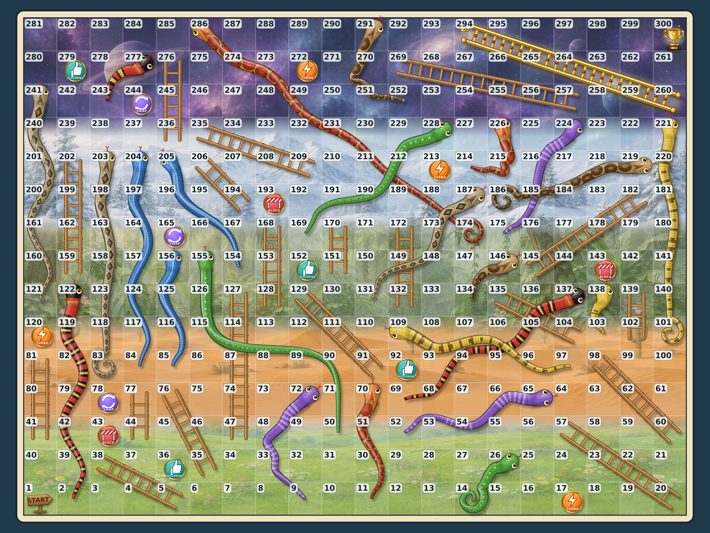

# סולמות ונחשים 300

לוח סולמות ונחשים בן 300 משבצות (20 עמודות × 15 שורות), להדפסה ביחס 4:3.



## מבנה הפרויקט

```
src/gen.py        חיפוש פריסה: מיקום נחשים וסולמות לפי החוקים, חישוב אורך משחק צפוי
src/render.py     ציור הלוח ל-SVG (משבצות, מספרים, נחשים, סולמות)
src/elements.py   נחשים וסולמות חצי-ריאליסטיים, שלט START מעץ וגביע זהב (וקטורי)
src/photo.py      רקע ריאליסטי מתמונות (assets/backgrounds): חיתוך, עמעום ומעבר בין עולמות
src/worlds.py     רקע "מעבר בין עולמות": אחו, מדבר, ג'ונגל, ארקטי, חלל
src/layout2.json  הפריסה הנוכחית (גרסה 2, נוצרת ע"י gen2.py)
src/layout.json   הפריסה הקודמת (גרסה 1, שמורה גם בענף reference-v1)
src/gen2.py       מחולל פריסה v2: סולם זהב, נחש אחד באזור הסיום, נחשים מתפתלים, משבצות פעולה
src/sim.py        סימולציית משחק מרובה שחקנים עם משבצות פעולה
output/           board.pdf (להדפסה), board.svg (לעריכה), preview.png
reference/        תמונת הלוח המקורי בן 100 המשבצות
build.sh          הרצת הכול
prompts.md        פרומפטים לרקעים ריאליסטיים (5 עולמות)
```

## הרצה

דרוש Python 3 עם numpy, ו-`rsvg-convert` (librsvg).

```bash
./build.sh              # רינדור מחדש מהפריסה הקיימת
./build.sh search 200   # חיפוש פריסה חדשה (200 ניסיונות) ורינדור
THEME=worlds ./build.sh    # רקע עולמות מצויר בקוד (בלי תמונות)
THEME=classic ./build.sh   # משבצות צבעוניות פשוטות
STYLE=cartoon ./build.sh   # נחשים וסולמות בסגנון המצויר הפשוט
```

## נחשים, סולמות, START וגביע (ברירת המחדל: חצי-ריאליסטי)

- **נחשים:** 8 "מינים" עם עור בהשראת נחשים אמיתיים: פיתון, נחש אלמוגים, נחש עצים ירוק, יהלומים, נחש תירס, כחול עם פס, צהוב עם פסים, סגול עם טבעות. לכל נחש יש הצללה תלת-ממדית וקשקשים, וראש רחב עם עיניים גדולות וידידותיות.
- **סולמות:** מוטות עץ מעוגלים עם טקסטורת סיבים, צל וברגים.
- **START:** שלט עץ בצורת חץ, נעוץ בתלולית אדמה עם דשא.
- **גביע:** גביע זהב מבריק על בסיס עץ כהה, עם כוכב וניצוצות.

## רקע ריאליסטי (ברירת המחדל)

התמונות נמצאות ב-`assets/backgrounds/` (meadow, desert, jungle, arctic, space) ונוצרו עם הפרומפטים שב-`prompts.md`.
- כל תמונה נחתכת לרצועה של העולם שלה ולא נמתחת. גובה החיתוך נקבע לכל עולם ב-`CROP_TOP` בקובץ `src/photo.py`.
- כוונון צבע לכל עולם בנפרד (רוויה, ניגודיות, בהירות): `TUNE` ב-`src/photo.py`. האחו והמדבר מוגברים מעט כי התמונות שלהם יצאו חיוורות יותר.
- המספרים מופיעים על תגית לבנה חצי-שקופה, וכך קריאים על כל רקע.
- **רזולוציה:** התמונות הנוכחיות ברוחב 2172 פיקסלים, שזה כ-100 DPI בהדפסה ב-60 ס״מ. לפני הדפסה כדאי להגדיל אותן פי 2–4 (למשל ב-Upscayl) ולהחליף את הקבצים באותם שמות. הקוד מתאים את עצמו לכל גודל.

## רקע מצויר: מעבר בין עולמות

כל 3 שורות הן עולם אחר, מלמטה למעלה:

| שורות | משבצות | עולם |
|---|---|---|
| 1–3 | 1–60 | אחו ירוק: גבעות, פרחים, פרפרים |
| 4–6 | 61–120 | מדבר: דיונות, קקטוסים, שמש |
| 7–9 | 121–180 | ג'ונגל: עלים טרופיים, מונסטרה, ליאנות |
| 10–12 | 181–240 | ארקטי: הרים מושלגים, אורורה, אורנים, פתיתי שלג |
| 13–15 | 241–300 | חלל: ערפיליות, גלקסיה ספירלית, כוכב לכת עם טבעת, רקטה |

כל עולם נכנס בהדרגה לתוך העולם שמתחתיו, ברצועת מעבר של 16 מ״מ. מעל הרקע יש שכבת לוח שחמט לבנה ושקופה וקווי רשת דקים, ככה שהמשבצות נשארות ברורות.

## חוקי המשחק (גרסה 2)

- משחקים עם **שתי קוביות**.
- מי שעובר את 300 **חוזר אחורה** ביתרה. צריך לנחות בדיוק על 300 כדי לנצח.
- **סולם הזהב** (סולם האליפות): 260→294.
- באזור הסיום (288–299) יש **נחש אחד בלבד**.

### משבצות פעולה

| משבצת | כמות | מה קורה |
|---|---|---|
| TURBO | 4 | תור נוסף מיד |
| BLOCK | 3 | הראשון שנוחת מפעיל מחסום נגד כל השאר. מי שעובר דרכו או נוחת עליו נעצר שם ומפסיד את התור הבא. אחרי שמישהו נתקע, המחסום יורד |
| HITCHHIKE | 4 | בתור הבא, השחקן שאחריך זורק, אתה מתקדם לפי הזריקה שלו, והוא נשאר במקום |
| SWAP | 3 (ליד 70, 150–170, 250) | מחליפים מקום עם שחקן שמעליך. אם יש כמה שחקנים מעליך, קובייה מחליטה עם מי |

### סטטיסטיקה (סימולציה, סבבים עד המנצח הראשון)

| שחקנים | ממוצע | חציון | 10% הארוכים |
|---|---|---|---|
| 2 | 68 | 60 | 109 |
| 3 | 57 | 52 | 87 |
| 4 | 51 | 48 | 75 |

לכל שחקן קורה משהו (נחש, סולם או משבצת פעולה) **פעם ב-5.2 תורות** בממוצע. בלוח המקורי: פעם ב-5.

## מפרט

**מבנה ומספור**
- 20×15 משבצות. המספור בצורת נחש: שורה 1 היא 1–20 משמאל לימין, שורה 2 היא 21–40 מימין לשמאל, וכן הלאה עד 300.
- קובץ ההדפסה בגודל 60×45 ס״מ (4:3). אפשר להגדיל ל-80×60 בלי איבוד איכות כי הקובץ וקטורי.
- A2 אינו 4:3 (‏59.4×42, יחס ‎1:√2). אם מדפיסים עליו, יישארו שוליים בצדדים.

**כמויות ואורכים (פי 3 מהמקור)**
- בלוח המקורי: כ-10 נחשים ו-9 סולמות. כאן: 27 נחשים ו-25 סולמות.
- אורכי הקפיצות נגזרו מהלוח המקורי, הוכפלו פי 3, בתוספת ±20% אקראיות (מינימום 12 משבצות).

**חוקי קריאוּת**
- המספרים מודפסים בפינה העליונה של המשבצת, מעל כל הציורים ועם הילה לבנה, ולכן לעולם לא מוסתרים.
- לכל היותר 2 אלמנטים במשבצת אחת (`MAX_PER_CELL` ב-gen.py).
- משבצת שבה נחש או סולם מתחיל או נגמר שייכת לו בלבד.
- אין הצטלבות בין שני סולמות.
- כל אלמנט חוצה לכל היותר אלמנט אחד אחר.
- הפרש עמודות מקסימלי של 6 בין ראש לזנב, כדי למנוע אלמנטים "שוכבים".
- אין ראש נחש ב-24 המשבצות הראשונות. אין נחש או סולם במשבצות 1 ו-300.

**איזון המשחק** (שחקן בודד, קובייה אחת, חריגה מעבר ל-300 = נשארים במקום)
| לוח | זריקות בממוצע |
|---|---|
| מקורי, 100 משבצות (קריאה משוערת מהתמונה) | ~40 |
| 300 משבצות בלי נחשים וסולמות | ~90 |
| הפריסה הנוכחית | ~121 |

החיפוש מדרג פריסות לפי: מספר האלמנטים, מעט הצטלבויות, פיזור אחיד של נחשים בין 5 אזורי הצבע, ואורך משחק צפוי קרוב ל-110 זריקות.

## רעיונות להמשך
- גרסאות פריסה נוספות לבחירה.
- נחשים וסולמות שמתאימים לכל עולם (למשל סולם קרח, נחש מדבר).
- כותרת ומסגרת מעוצבת.
- גרסה מקוצרת לילדים: יותר סולמות ארוכים, או משחק עם 2 קוביות.
